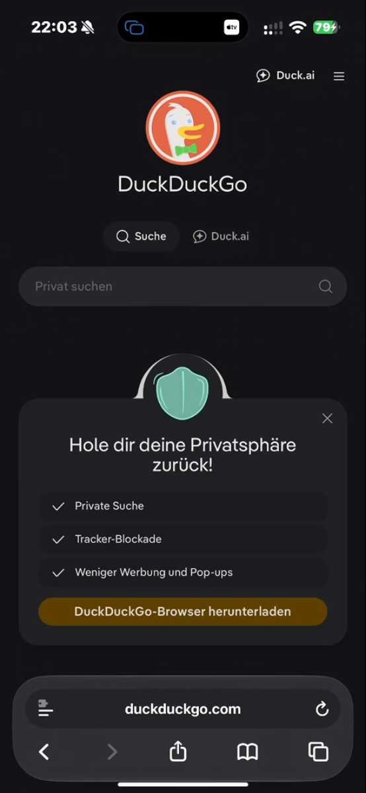
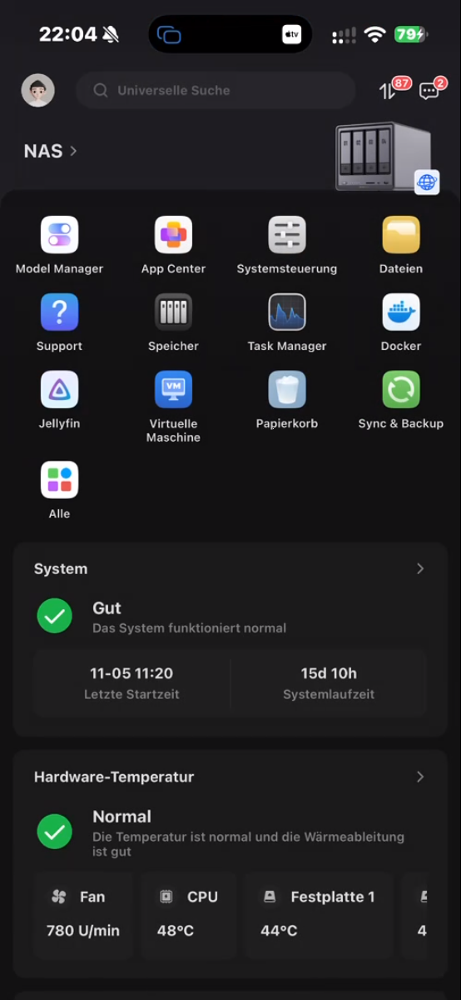
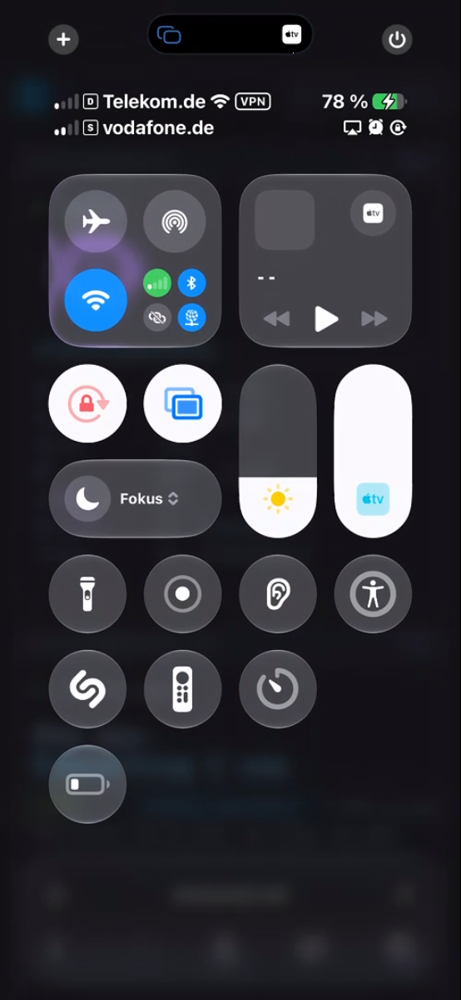
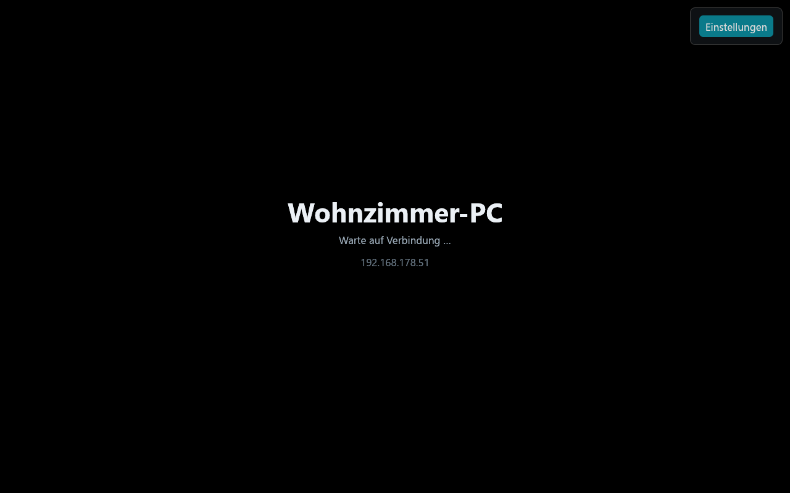
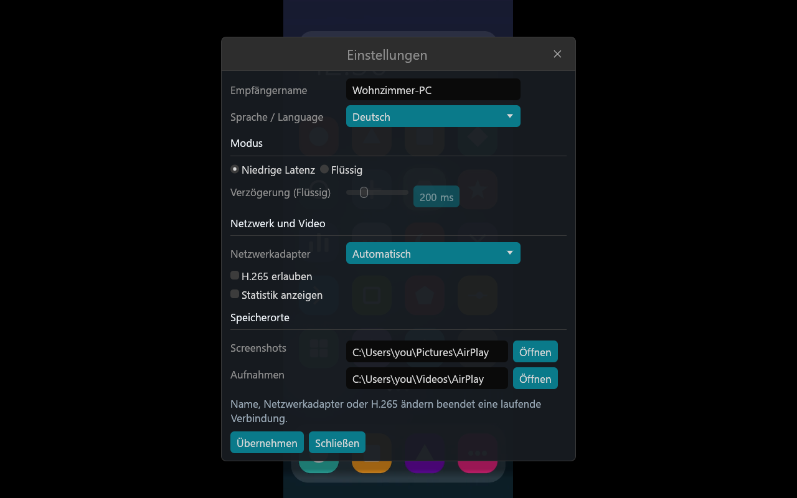

# AirPlay-Empfänger

Eigener AirPlay-Empfänger für Windows: iPhone und iPad spiegeln Bildschirm und Ton auf den PC – mit möglichst wenig Verzögerung.

  
  
  

Echtes iPhone, gespiegelt ins Empfängerfenster (Fenster auf Handyformat gezogen, ohne Ränder).

*English version: [README.md](README.md)*

## Funktionen

- Bild über die Grafikkarte dekodiert (D3D11VA) und direkt angezeigt
- Ton (AAC-ELD) in eigenem Thread, läuft auch beim Verschieben des Fensters weiter
- Zwei Modi: **Niedrige Latenz** und **Flüssig**
- Screenshot (PNG) und Aufnahme (MP4 mit Ton)
- Optionale Statistik-Einblendung (**Statistik anzeigen** in den Einstellungen)
- Kein Apple Bonjour/iTunes nötig – Ankündigung über die in Windows eingebaute DNS-SD-Funktion
- Oberfläche auf Deutsch oder Englisch (richtet sich nach der Windows-Anzeigesprache, in den Einstellungen änderbar)

## Download & Benutzen

1. **Empfohlen – Installer:** `airplay-receiver-<tag>-setup.exe` von der [Releases-Seite](https://github.com/Ariazonaa/airplay-receiver/releases) laden und ausführen. Er installiert nach `C:\Program Files\AirPlay Receiver`, legt einen Startmenü-Eintrag an (optional ein Desktop-Symbol) und erstellt die Firewall-Regel (nur lokales Subnetz, nur diese `.exe`), Schritt 2 entfällt also. Das Setup ist nicht signiert, daher zeigt Windows SmartScreen „Der Computer wurde durch Windows geschützt“: auf **Weitere Informationen** → **Trotzdem ausführen** klicken. Deinstallieren über Windows-Einstellungen → Apps; dabei wird auch die Firewall-Regel entfernt, die Einstellungen in `%APPDATA%\airplay` und die Logs in `%LOCALAPPDATA%\airplay` bleiben erhalten.
   **Alternative – portabel:** `airplay-receiver-<tag>-windows-x64.zip` laden, entpacken und `airplay.exe` starten. (Oder selbst bauen, siehe [Bauen](#bauen).)
2. Nur bei der portablen ZIP: Beim ersten Start unten im Fenster auf **„Firewall-Regel anlegen“** klicken und die Windows-Abfrage bestätigen. Die Regel gilt nur für Geräte im eigenen Netz (lokales Subnetz) und nur für diese `.exe` – wird das Programm an einen anderen Ort verschoben, einmal erneut anlegen.
3. Auf dem iPhone/iPad: Kontrollzentrum → **Bildschirmsynchronisierung** → Name des PCs.

**Mullvad/VPN:** Mit aktivem Mullvad muss „Lokales Netzwerk teilen“ eingeschaltet sein, sonst erreicht das iPhone den PC nicht.

### Tasten

| Taste | Wirkung |
|---|---|
| F11 | Vollbild an/aus |
| Esc | Vollbild verlassen |
| Strg+T | Immer im Vordergrund an/aus |
| F9 | Screenshot |
| F10 | Aufnahme starten/stoppen |

### Modi

- **Niedrige Latenz** (Standard): Jedes Bild wird sofort gezeigt, der Ton hält ~60 ms Puffer und wird weich (±2 % Tempo) nachgeregelt. Für Spiele und Bedienen.
- **Flüssig**: Bild und Ton laufen nach Zeitstempeln synchron. Die eingestellte Verzögerung (100–500 ms, Standard 200 ms) gilt ab Ankunft am PC; der Vorlauf, den iOS selbst einplant (gemessen ~180 ms Ton, ~100 ms Bild), wird automatisch berücksichtigt. Für Videos.

Umschalten über **Einstellungen** (Knopf oben rechts, erscheint bei Mausbewegung). Dort lässt sich auch die Sprache wählen: *Automatisch (Windows)*, *Deutsch* oder *English*.

Während einer Aufnahme erscheint oben links eine rote **REC**-Anzeige mit der Laufzeit.

### Speicherorte

- Screenshots: `Bilder\AirPlay\AirPlay_JJJJ-MM-TT_hh-mm-ss.png`
- Aufnahmen: `Videos\AirPlay\AirPlay_JJJJ-MM-TT_hh-mm-ss.mp4`, nach dem Drehen des Geräts `…_teil2.mp4` usw.
- Einstellungen: `%APPDATA%\airplay\config.json`
- Log (inkl. Diagnosezeilen alle 2 s): `%LOCALAPPDATA%\airplay\logs\airplay.log`

Die Ordner sind in den Einstellungen änderbar.

### Bekannte Grenzen

- Netflix, Disney+, Apple TV+ u. Ä. zeigen wegen Kopierschutz meist nur Schwarz.
- Ein Gerät zur Zeit; ein neu verbundenes Gerät übernimmt.
- Mac als Quelle, reiner Audio-Empfang (PC als Lautsprecher) und URL-Casting werden nicht unterstützt.
- Hochkant schickt das iPhone nur 498×1080, weil es in den gemeldeten 1080p-Rahmen skaliert.

## Latenz

Gemessen im Log (iPhone19,7, Ethernet, 2026-11-20):

| Modus | Ton-Puffer | Bild |
|---|---|---|
| Niedrige Latenz | 53–81 ms | sofort bei Ankunft |
| Flüssig (200 ms) | 187–205 ms | synchron zum Ton |

Ein Vergleich Bild-zu-Bild mit Stoppuhr gegen LonelyScreen steht noch aus.

## Bauen

1. MSYS2 installieren (`winget install MSYS2.MSYS2`), dann in der MSYS2-Shell:
   `pacman -S --needed git mingw-w64-ucrt-x86_64-{toolchain,rust,clang,pkgconf,openssl,libplist,ffmpeg,sdl3}`
   (das MSYS2-Paket `ffmpeg` brauchen nur die Tests als Kommandozeilenwerkzeug; das Programm linkt einen eigenen FFmpeg-Build).
2. Vor dem ersten Bauen einmal FFmpeg bauen (FFmpeg 9.1 nur mit den benutzten Komponenten, statisch, nach `build/ffmpeg-9.1`; dauert einige Minuten):
   `pacman -S --needed make diffutils mingw-w64-ucrt-x86_64-nasm`, dann aus PowerShell im Projektordner
   `C:\msys64\msys2_shell.cmd -ucrt64 -defterm -no-start -here -c "scripts/build-ffmpeg.sh"`.
   Das Skript lädt den Quell-Tarball, prüft die SHA256 und tut nichts, wenn der Build schon da ist.
3. Aus PowerShell im Projektordner:
   - Bauen + Clippy (`cargo build`): `C:\msys64\msys2_shell.cmd -ucrt64 -defterm -no-start -here -c "scripts/build.sh"`
   - Tests: `cargo test` in der UCRT64-Shell (`AIRPLAY_CI=1 cargo test` auf einem Rechner ohne Hardware-GPU oder Netzwerk, die betroffenen Tests melden dann einen Skip).
   - Optional: die Tests statt auf dem Host in einer Windows Sandbox ausführen (keine Firewall-Abfragen, keine Ankündigungen im eigenen Netz): `powershell -NoProfile -ExecutionPolicy Bypass -File scripts\sandbox.ps1 test`. Setzt Windows Sandbox mit der `wsb`-CLI voraus (Windows 11 Pro/Enterprise).
   - Programmordner `dist\airplay`: `C:\msys64\msys2_shell.cmd -ucrt64 -defterm -no-start -here -c "scripts/bundle.sh"`
   - Installer `dist\airplay-receiver-<tag>-setup.exe` (braucht [Inno Setup 6](https://jrsoftware.org/isinfo.php), z. B. `winget install JRSoftware.InnoSetup`, und `dist\airplay` aus dem vorigen Schritt): `powershell -NoProfile -ExecutionPolicy Bypass -File scripts\build-installer.ps1 [-Version x.y.z] [-Tag <tag>]`

Zur Fehlersuche ohne Fenster gibt es `airplay-probe.exe` im Programmordner (kündigt an, nimmt Verbindungen an, zeigt Paketzähler).

### Entwicklung

`target\release\airplay.exe --demo docs\demo\demo.h264` (im Projektordner ausgeführt) spielt ein selbst erzeugtes Demo-Video ohne Handy durch die echte Pipeline (Dekoder, Darstellung, Oberfläche), praktisch zum Testen des Bildwegs; siehe [docs/demo/README.md](docs/demo/README.md) und `scripts/make-demo.ps1`.

## Mitmachen

Issues und Pull Requests sind erwünscht und werden in der Regel innerhalb von 3 Tagen bearbeitet – siehe [CONTRIBUTING.md](CONTRIBUTING.md).

## Hinweis

Dieses Projekt steht in keiner Verbindung zu Apple und wird von Apple nicht unterstützt oder empfohlen. „AirPlay“ ist eine Marke von Apple Inc. Der Code für den FairPlay-Handshake stammt aus UxPlay/RPiPlay („playfair“). Kopiergeschützte Streams werden schwarz angezeigt. Nur mit eigenen Geräten verwenden.

## Lizenz

GPL-3.0, siehe [LICENSE](LICENSE). FFmpeg 9.1 (LGPL-2.1-or-later, ohne GPL-Teile und ohne externe Codec-Bibliotheken gebaut) ist statisch gelinkt (gebaut von `scripts/build-ffmpeg.sh`). Der vollständige Quellcode („Corresponding Source“) des gebündelten FFmpeg ist unter https://ffmpeg.org/releases/ffmpeg-9.1.tar.xz erhältlich (unveränderter Release-Tarball, SHA256 `1a4d394ae63d190a526cd052eb4415c156b5c5e2df37efab41a7de0b8fde2433`); diese URL, die SHA256 und die vollständige Configure-Zeile stehen auch in `licenses/FFmpeg-BUILD-INFO.txt` im Programmordner, der Lizenztext in `licenses/FFmpeg-LGPL-2.1.txt`, FFmpegs Hinweise zu Dateien mit eigenen Bedingungen in `licenses/FFmpeg-LICENSE.md` und die Copyright- und Erlaubnistexte der kompilierten FFmpeg-Dateien unter anderen freizügigen Lizenzen (libjpeg/IJG, MIT, BSD, ISC) in `licenses/FFmpeg-NOTICES.txt`. This software is based in part on the work of the Independent JPEG Group. (Dieses Programm beruht teilweise auf der Arbeit der Independent JPEG Group.) Der AirPlay-Protokollkern stammt aus [UxPlay](https://github.com/FDH2/UxPlay) v1.73.7 (GPL-3.0), siehe `third_party/uxplay/VENDORED.md`. egui steht unter MIT/Apache-2.0; die von egui eingebetteten Schriften unter der Ubuntu Font Licence 1.0 (Ubuntu Light), MIT/Bitstream-Vera-Lizenz (Hack), MIT (egui-Icons aus emoji-icon-font) und Noto Emoji (SIL OFL 1.1). Die Lizenzen aller verwendeten Rust-Crates stehen in [THIRD-PARTY-LICENSES.txt](THIRD-PARTY-LICENSES.txt). Die Lizenztexte von egui und den Schriften liegen in `third_party/licenses/`. `scripts/bundle.sh` kopiert sie in den Ordner `licenses` des Programmverzeichnisses, zusammen mit `THIRD-PARTY-LICENSES.txt`, der GPL-3.0 von airplay und UxPlay, den genannten FFmpeg-Dateien und den Lizenztexten der gebündelten MSYS2-DLLs (`licenses/dll/`, Zuordnung in `licenses/dll/PACKAGES.txt`).
