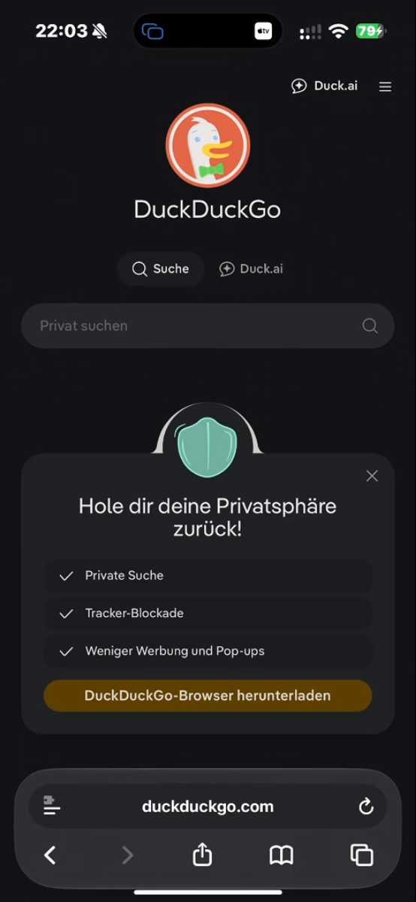
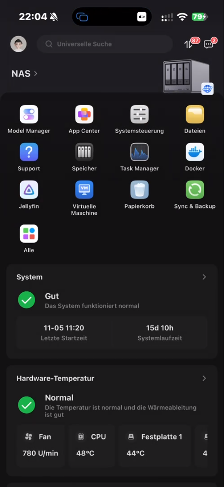
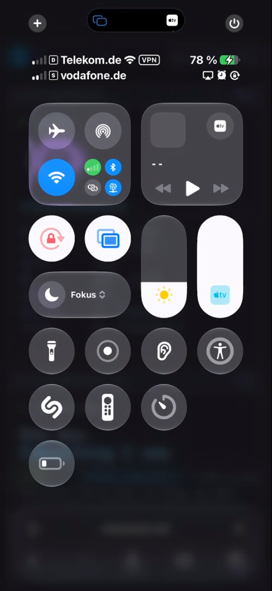
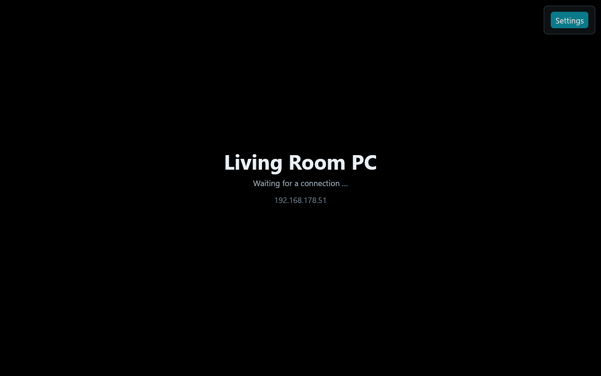
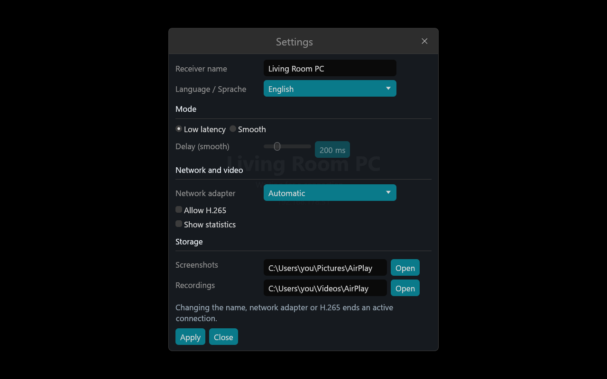

# AirPlay Receiver

A custom AirPlay receiver for Windows: iPhone and iPad mirror their screen and sound to the PC – with as little latency as possible.

  
  
  

Real iPhone, mirrored into the receiver window (window sized to the phone, no borders).

*Deutsche Fassung: [README.de.md](README.de.md)*

## Features

- Video decoded on the GPU (D3D11VA) and shown directly
- Audio (AAC-ELD) on its own thread, keeps playing while the window is moved
- Two modes: **Low latency** and **Smooth**
- Screenshot (PNG) and recording (MP4 with sound)
- Optional statistics overlay (**Show statistics** in the settings)
- No Apple Bonjour/iTunes needed – announced via the DNS-SD service built into Windows
- User interface in German or English (follows the Windows display language, can be changed in the settings)

## Download & usage

1. **Recommended – installer:** download `airplay-receiver-<tag>-setup.exe` from the [Releases page](https://github.com/Ariazonaa/airplay-receiver/releases) and run it. It installs to `C:\Program Files\AirPlay Receiver`, adds a Start menu entry (optional desktop icon) and creates the firewall rule (local subnet only, this `.exe` only), so step 2 is not needed. The setup is not code-signed, so Windows SmartScreen shows “Windows protected your PC”: click **More info** → **Run anyway**. Uninstall via Windows Settings → Apps; this also removes the firewall rule and keeps your settings in `%APPDATA%\airplay` and the logs in `%LOCALAPPDATA%\airplay`.
   **Alternative – portable:** download `airplay-receiver-<tag>-windows-x64.zip`, extract it and start `airplay.exe`. (Or build it yourself, see [Building](#building).)
2. Portable ZIP only: on first start click **“Add firewall rule”** at the bottom of the window and confirm the Windows prompt. The rule only allows devices on your own network (local subnet) and only this `.exe` – if you move the program, add it once more.
3. On the iPhone/iPad: Control Center → **Screen Mirroring** → name of the PC.

**Mullvad/VPN:** with Mullvad active, “Local network sharing” must be enabled, otherwise the iPhone cannot reach the PC.

### Keys

| Key | Action |
|---|---|
| F11 | Toggle fullscreen |
| Esc | Leave fullscreen |
| Ctrl+T | Toggle always on top |
| F9 | Screenshot |
| F10 | Start/stop recording |

### Modes

- **Low latency** (default): every frame is shown immediately; audio keeps a ~60 ms buffer and is adjusted gently (±2 % speed). For games and interaction.
- **Smooth**: picture and sound play in sync by timestamp. The configured delay (100–500 ms, default 200 ms) counts from arrival at the PC; the lead that iOS plans in by itself (measured ~180 ms audio, ~100 ms video) is taken into account automatically. For videos.

Switch in **Settings** (button at the top right, appears when the mouse moves). The language is set there too: *Automatic (Windows)*, *Deutsch* or *English*.

While recording, a red **REC** indicator with the elapsed time is shown at the top left.

### Where files go

- Screenshots: `Pictures\AirPlay\AirPlay_YYYY-MM-DD_hh-mm-ss.png`
- Recordings: `Videos\AirPlay\AirPlay_YYYY-MM-DD_hh-mm-ss.mp4`, after rotating the device `…_teil2.mp4` etc.
- Settings: `%APPDATA%\airplay\config.json`
- Log (incl. diagnostic lines every 2 s, in German): `%LOCALAPPDATA%\airplay\logs\airplay.log`

The folders can be changed in the settings.

### Known limits

- Netflix, Disney+, Apple TV+ and similar usually show only black because of copy protection.
- One device at a time; a newly connected device takes over.
- Mac as a source, audio-only receiving (PC as speaker) and URL casting are not supported.
- In portrait the iPhone only sends 498×1080 because it scales into the announced 1080p frame.

## Latency

Measured from the log (iPhone19,7, Ethernet, 2026-11-20):

| Mode | Audio buffer | Picture |
|---|---|---|
| Low latency | 53–81 ms | immediately on arrival |
| Smooth (200 ms) | 187–205 ms | in sync with audio |

A glass-to-glass stopwatch comparison against LonelyScreen is still pending.

## Building

1. Install MSYS2 (`winget install MSYS2.MSYS2`), then in the MSYS2 shell:
   `pacman -S --needed git mingw-w64-ucrt-x86_64-{toolchain,rust,clang,pkgconf,openssl,libplist,ffmpeg,sdl3}`
   (the MSYS2 `ffmpeg` package is only used by the tests as a command-line tool; the program links its own FFmpeg build).
2. Build FFmpeg once before the first build (FFmpeg 9.1 with only the components the program uses, static, into `build/ffmpeg-9.1`; takes a few minutes):
   `pacman -S --needed make diffutils mingw-w64-ucrt-x86_64-nasm`, then from PowerShell in the project folder
   `C:\msys64\msys2_shell.cmd -ucrt64 -defterm -no-start -here -c "scripts/build-ffmpeg.sh"`.
   The script downloads the source tarball, checks its SHA256 and does nothing if the build is already there.
3. From PowerShell in the project folder:
   - Build + clippy (`cargo build`): `C:\msys64\msys2_shell.cmd -ucrt64 -defterm -no-start -here -c "scripts/build.sh"`
   - Tests: `cargo test` in the UCRT64 shell (`AIRPLAY_CI=1 cargo test` on a machine without a hardware GPU or network, the affected tests then report a skip).
   - Optional: run the tests in a Windows Sandbox instead of on the host (no firewall prompts, no announcements on your network): `powershell -NoProfile -ExecutionPolicy Bypass -File scripts\sandbox.ps1 test`. Needs Windows Sandbox with the `wsb` CLI (Windows 11 Pro/Enterprise).
   - Program folder `dist\airplay`: `C:\msys64\msys2_shell.cmd -ucrt64 -defterm -no-start -here -c "scripts/bundle.sh"`
   - Installer `dist\airplay-receiver-<tag>-setup.exe` (needs [Inno Setup 6](https://jrsoftware.org/isinfo.php), e.g. `winget install JRSoftware.InnoSetup`, and `dist\airplay` from the previous step): `powershell -NoProfile -ExecutionPolicy Bypass -File scripts\build-installer.ps1 [-Version x.y.z] [-Tag <tag>]`

For troubleshooting without a window there is `airplay-probe.exe` in the program folder (announces, accepts connections, shows packet counters).

### Development

`target\release\airplay.exe --demo docs\demo\demo.h264` (run in the project folder) plays a self-made demo video through the real pipeline (decoder, renderer, UI) without a phone, handy for testing the picture path; see [docs/demo/README.md](docs/demo/README.md) and `scripts/make-demo.ps1`.

## Contributing

Issues and pull requests are welcome and are usually answered within 3 days – see [CONTRIBUTING.md](CONTRIBUTING.md).

## Disclaimer

This project is not affiliated with or endorsed by Apple. “AirPlay” is a trademark of Apple Inc. The FairPlay handshake code comes from UxPlay/RPiPlay (“playfair”). Copy-protected streams are shown black. Use it only with your own devices.

## License

GPL-3.0, see [LICENSE](LICENSE). FFmpeg 9.1 (LGPL-2.1-or-later, built without GPL parts and without external codec libraries) is linked statically (built by `scripts/build-ffmpeg.sh`). The Corresponding Source of the bundled FFmpeg is available at https://ffmpeg.org/releases/ffmpeg-9.1.tar.xz (unmodified release tarball, SHA256 `1a4d394ae63d190a526cd052eb4415c156b5c5e2df37efab41a7de0b8fde2433`); this URL, the SHA256 and the full configure line are also in `licenses/FFmpeg-BUILD-INFO.txt` of the program folder, the license text in `licenses/FFmpeg-LGPL-2.1.txt`, FFmpeg's notes on files with their own terms in `licenses/FFmpeg-LICENSE.md`, and the copyright and permission notices of the compiled FFmpeg files under other permissive licenses (libjpeg/IJG, MIT, BSD, ISC) in `licenses/FFmpeg-NOTICES.txt`. This software is based in part on the work of the Independent JPEG Group. The AirPlay protocol core comes from [UxPlay](https://github.com/FDH2/UxPlay) v1.73.7 (GPL-3.0), see `third_party/uxplay/VENDORED.md`. egui is MIT/Apache-2.0 licensed; the fonts embedded by egui are under the Ubuntu Font Licence 1.0 (Ubuntu Light), MIT/Bitstream Vera License (Hack), MIT (egui icons from emoji-icon-font) and Noto Emoji (SIL OFL 1.1). The licenses of all Rust crates used are listed in [THIRD-PARTY-LICENSES.txt](THIRD-PARTY-LICENSES.txt). The license texts of egui and the fonts are in `third_party/licenses/`. `scripts/bundle.sh` copies them into the `licenses` folder of the program directory, together with `THIRD-PARTY-LICENSES.txt`, the GPL-3.0 of airplay and UxPlay, the FFmpeg files mentioned above, and the license texts of the bundled MSYS2 DLLs (`licenses/dll/`, mapping in `licenses/dll/PACKAGES.txt`).
